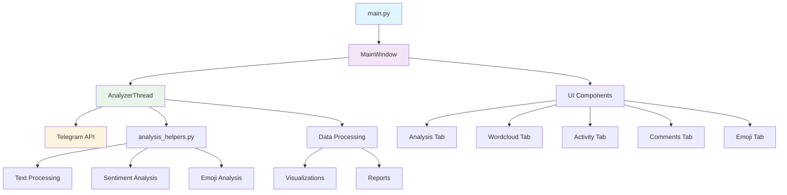
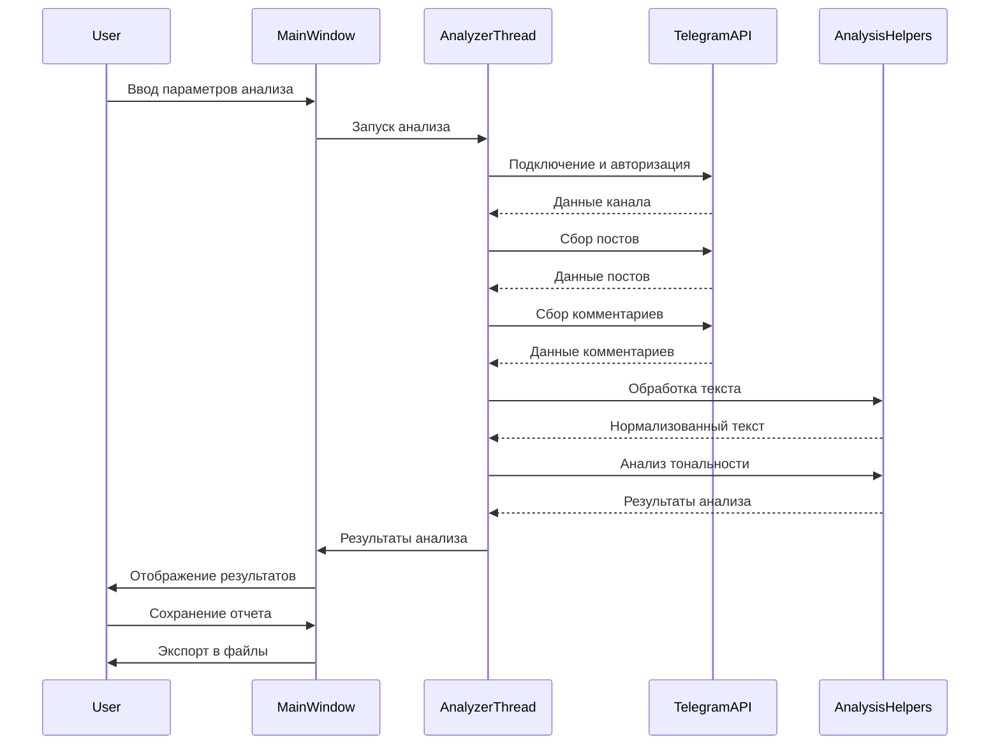
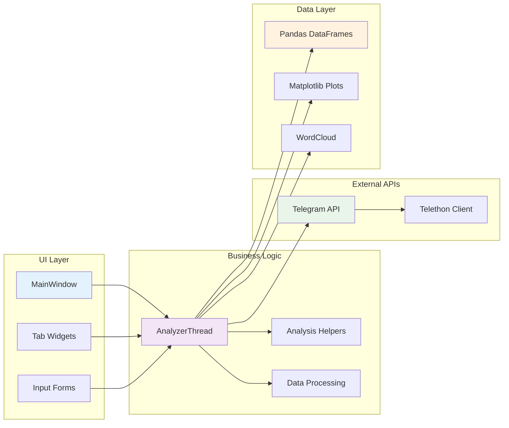

# 📊 Телеграф Анализатор - Документация

## 🎯 Описание проекта

**Телеграф Анализатор** — это десктопное приложение для комплексного анализа Telegram-каналов. Приложение собирает данные о подписчиках, просмотрах постов, реакциях и комментариях, предоставляя подробную аналитику с визуализацией и рекомендациями для развития канала.

### 🚀 Ключевые возможности

- 📈 **Ключевые метрики**: Сбор данных о подписчиках, просмотрах, реакциях и расчет Engagement Rate (ER)
- 💬 **Анализ комментариев**: Определение тональности, облако популярных слов, примеры комментариев
- ☁️ **Облака слов**: Визуализация основных тем контента из постов
- 📅 **Графики активности**: Анализ активности по дням и часам для оптимизации времени публикаций
- 👥 **Активность аудитории**: Анализ активности подписчиков в комментариях по часам
- 🥳 **Статистика Emoji**: Анализ популярных эмодзи в постах и комментариях
- 🔐 **Безопасная авторизация**: Подключение через API ID/Hash с локальной обработкой данных
- ⚙️ **Гибкая настройка**: Выбор периода анализа, лимиты на сообщения и комментарии
- 🎨 **Современный интерфейс**: Дизайн в стиле Fusion с поддержкой светлой и темной тем
- 💾 **Экспорт отчетов**: Сохранение данных в CSV и текстовые отчеты

---

## 1. 📁 Структура проекта

```
tg_rate/
├── main.py                 # Точка входа приложения
├── main_window.py          # Главное окно и UI компоненты
├── analyzer_thread.py      # Поток анализа данных Telegram
├── analysis_helpers.py     # Вспомогательные функции анализа
├── config.py              # Конфигурация и стили
├── requirements.txt       # Зависимости проекта
└── README.md             # Документация (этот файл)
```

---

## 2. 📄 Описание файлов

### 2.1 `main.py` - Точка входа
**Назначение**: Запуск приложения и инициализация главного окна

**Ключевые функции**:
- Создание экземпляра QApplication
- Установка стиля Fusion
- Создание и отображение главного окна

**Связи**: Импортирует `MainWindow` из `main_window.py`

**Логика**: Минимальный файл-точка входа, который запускает PyQt5 приложение.

### 2.2 `main_window.py` - Главное окно приложения
**Назначение**: Основной интерфейс пользователя с вкладками для различных типов анализа

**Ключевые классы**:
- `MainWindow`: Главный класс окна приложения

**Ключевые функции**:
- `init_ui()`: Инициализация пользовательского интерфейса
- `start_analysis()`: Запуск процесса анализа
- `display_results()`: Отображение результатов анализа
- `save_report()`: Сохранение отчетов в файлы
- `toggle_theme()`: Переключение между светлой и темной темами

**Связи**:
- Импортирует `AnalyzerThread` из `analyzer_thread.py`
- Импортирует функции анализа из `analysis_helpers.py`
- Импортирует стили и конфигурацию из `config.py`

**Логика**: Создает многоуровневый интерфейс с вкладками для различных типов анализа, управляет процессом анализа через отдельный поток и отображает результаты в удобном формате.

### 2.3 `analyzer_thread.py` - Поток анализа данных
**Назначение**: Асинхронный сбор и обработка данных из Telegram API

**Ключевые классы**:
- `AnalyzerThread`: Класс потока для анализа данных

**Ключевые функции**:
- `fetch_data()`: Основная функция сбора данных
- `fetch_comments_for_posts()`: Сбор комментариев для постов
- `generate_insights()`: Генерация визуализаций и рекомендаций
- `generate_hourly_insights()`: Создание графиков часовой активности

**Связи**:
- Использует `TelegramClient` для работы с Telegram API
- Импортирует функции из `analysis_helpers.py`
- Импортирует конфигурацию из `config.py`

**Логика**: Асинхронно подключается к Telegram API, собирает данные о канале, постах и комментариях, обрабатывает их и создает визуализации.

### 2.4 `analysis_helpers.py` - Вспомогательные функции анализа
**Назначение**: Функции для обработки текста и анализа данных

**Ключевые функции**:
- `normalize_text()`: Нормализация и лемматизация текста
- `analyze_sentiment()`: Анализ тональности текста
- `get_emoji_stats()`: Подсчет статистики эмодзи

**Связи**:
- Импортирует конфигурацию из `config.py`
- Использует `pymorphy2` для морфологического анализа
- Использует библиотеку `emoji` для анализа эмодзи

**Логика**: Предоставляет функции для обработки текста, определения тональности комментариев и анализа использования эмодзи.

### 2.5 `config.py` - Конфигурация и стили
**Назначение**: Централизованное хранение конфигурации, стилей и словарей

**Ключевые компоненты**:
- `DEFAULT_STYLE`: Стили для светлой темы
- `DARK_STYLE`: Стили для темной темы
- `positive_words`: Словарь позитивных слов для анализа тональности
- `negative_words`: Словарь негативных слов для анализа тональности
- `russian_stopwords`: Стоп-слова для фильтрации

**Связи**:
- Инициализирует `pymorphy2.MorphAnalyzer()`
- Загружает NLTK стоп-слова
- Импортирует библиотеку `emoji`

**Логика**: Централизует все настройки приложения, включая стили интерфейса, словари для анализа тональности и инициализацию внешних библиотек.

---

## 3. 🏗️ Архитектура проекта

### 3.1 Общая структура



### 3.2 Потоки данных



### 3.3 Архитектурная схема



---

## 4. 📚 Библиотеки/фреймворки

| Библиотека | Назначение | Где используется |
|------------|------------|------------------|
| **PyQt5** | GUI фреймворк | `main.py`, `main_window.py` - создание интерфейса |
| **Telethon** | Telegram API клиент | `analyzer_thread.py` - работа с Telegram API |
| **Pandas** | Обработка данных | `analyzer_thread.py`, `main_window.py` - анализ данных |
| **NLTK** | Обработка естественного языка | `config.py` - стоп-слова |
| **WordCloud** | Создание облаков слов | `analyzer_thread.py` - визуализация |
| **Matplotlib** | Создание графиков | `analyzer_thread.py` - графики активности |
| **Pymorphy2** | Морфологический анализ | `analysis_helpers.py` - лемматизация |
| **Emoji** | Анализ эмодзи | `analysis_helpers.py` - подсчет эмодзи |

---

## 5. 🚀 Точка входа и запуск

### 5.1 Как запускается проект

1. **Инициализация приложения**: `main.py` создает экземпляр `QApplication`
2. **Создание главного окна**: Инициализируется `MainWindow` с интерфейсом
3. **Отображение окна**: Показывается главное окно приложения
4. **Ожидание действий пользователя**: Приложение ждет ввода параметров

### 5.2 Что выполняется первым

```python
# main.py - последовательность запуска
app = QApplication(sys.argv)          # 1. Создание приложения
app.setStyle("Fusion")                # 2. Установка стиля
window = MainWindow()                 # 3. Создание главного окна
window.show()                         # 4. Отображение окна
sys.exit(app.exec_())                 # 5. Запуск главного цикла
```

### 5.3 Процесс анализа

1. **Ввод параметров**: Пользователь вводит API ID, Hash, username канала
2. **Запуск потока**: Создается `AnalyzerThread` для асинхронной работы
3. **Подключение к Telegram**: Авторизация через API
4. **Сбор данных**: Получение информации о канале, постах, комментариях
5. **Обработка**: Анализ тональности, создание визуализаций
6. **Отображение результатов**: Показ результатов в интерфейсе

---

## 6. 🎯 Архитектурные особенности

### 6.1 Нестандартные решения

#### Асинхронная архитектура
- **Причина**: Telegram API требует асинхронных вызовов
- **Решение**: Использование `QThread` с `asyncio` для неблокирующей работы
- **Преимущества**: Интерфейс остается отзывчивым во время анализа

#### Интерактивная авторизация
- **Причина**: Telegram требует ввода номера телефона и кода подтверждения
- **Решение**: Система сигналов между потоком и главным окном
- **Особенность**: Первый запуск требует ввода данных в IDE (недоделанная функция)

#### Модульная обработка данных
- **Причина**: Разнообразные типы анализа требуют гибкости
- **Решение**: Отдельные функции в `analysis_helpers.py`
- **Преимущества**: Легкое добавление новых типов анализа

### 6.2 Причины выбора архитектуры

#### PyQt5 + QThread
- **Причина**: Необходимость создания десктопного приложения с GUI
- **Преимущества**: Кроссплатформенность, богатый функционал, асинхронность

#### Telethon
- **Причина**: Официальная Python библиотека для Telegram API
- **Преимущества**: Поддержка всех функций API, асинхронность, документация

#### Pandas + Matplotlib
- **Причина**: Эффективная обработка и визуализация данных
- **Преимущества**: Быстрая работа с большими объемами данных

---

## 7. 🔧 Установка и запуск

### 7.1 Требования
- Python 3.7+
- Telegram API ID и Hash (получить на https://my.telegram.org)

### 7.2 Установка зависимостей
```bash
pip install -r requirements.txt
```

### 7.3 Запуск приложения
```bash
python main.py
```

### 7.4 Первый запуск
⚠️ **Важно**: При первом запуске потребуется ввод номера телефона и кода подтверждения в IDE, так как функция авторизации не полностью реализована.

---

## 8. 📊 Возможности анализа

### 8.1 Основные метрики
- Количество подписчиков
- Средние просмотры на пост
- Engagement Rate (ER)
- Среднее количество реакций
- Среднее количество комментариев

### 8.2 Визуализации
- Облако слов из постов
- График активности по дням
- График активности по часам
- Активность аудитории в комментариях
- Статистика использования эмодзи

### 8.3 Анализ комментариев
- Определение тональности (позитив/негатив/нейтрал)
- Топ-10 популярных слов
- Примеры комментариев по тональности
- Анализ активности аудитории по времени

---

## 9. 🔒 Безопасность

### 9.1 Обработка данных
- Все данные обрабатываются локально на компьютере пользователя
- API ключи не передаются третьим лицам
- Сессии Telegram сохраняются локально

### 9.2 Авторизация
- Используется официальный Telegram API
- Поддержка двухфакторной аутентификации
- Безопасное хранение сессий

---

## 10. 🎨 Интерфейс

### 10.1 Вкладки приложения
1. **🔍 Анализ** - Основные параметры и результаты
2. **☁️ Облако слов** - Визуализация популярных слов
3. **📈 Активность (Дни)** - График активности по дням
4. **⏰ Активность (Часы)** - График активности по часам
5. **💬 Комментарии** - Анализ комментариев
6. **👥 Активность Аудитории** - Активность подписчиков
7. **📊 Emoji Статистика** - Статистика эмодзи

### 10.2 Темы оформления
- **Светлая тема** - Классический стиль Fusion
- **Темная тема** - Современный темный интерфейс

---

## 11. 📈 Экспорт данных

### 11.1 Форматы экспорта
- **CSV файл** - Детальные данные по постам
- **Текстовый отчет** - Сводка с основными показателями

### 11.2 Содержимое отчетов
- Основные метрики канала
- Анализ комментариев
- Статистика эмодзи
- Рекомендации по развитию

---

## 12. 🐛 Известные проблемы

### 12.1 Первый запуск
- Авторизация требует ввода номера телефона и кода в IDE
- Функция не полностью реализована

### 12.2 Ограничения API
- Лимиты на количество запросов к Telegram API
- Возможные задержки при сборе больших объемов данных

---

Автор: legenda  
Telegram: [@LEGENDA_SD](https://t.me/LEGENDA_SD)
